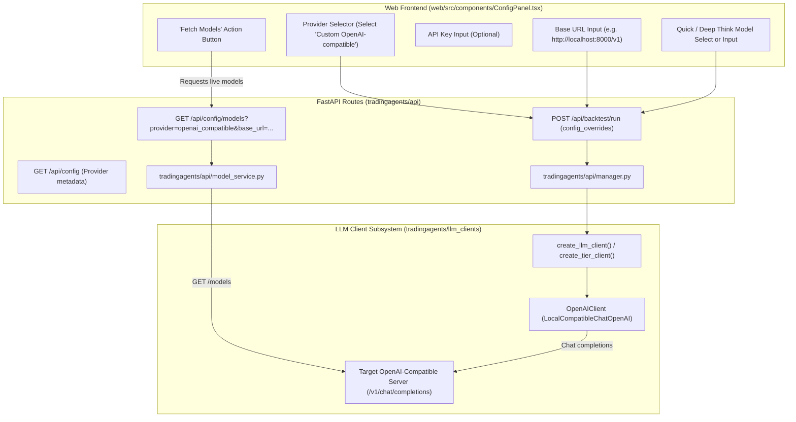

# Technical Design: Integrate OpenAI-Compatible Provider

**Status:** Completed
<!-- Lifecycle: Draft -> Approved -> Completed -->
**Topic Path:** `.trellis/research/11-03-openai-compatible-provider/`
**PRD Reference:** [prd.md](./prd.md)

## 1. System Architecture



## 2. API & Data Flow Changes

### 2.1 Backend: `tradingagents/api/routes/config.py` & `model_service.py`
- Modify `get_provider_models`:
  ```python
  @router.get("/models")
  def get_provider_models(
      provider: str,
      base_url: str | None = None,
      api_key: str | None = None,
  ):
      from tradingagents.api.model_service import get_models_for_provider
      return get_models_for_provider(provider, base_url=base_url, api_key=api_key)
  ```
- In `tradingagents/api/model_service.py`:
  - Add `_fetch_live_openai_compatible_models(base_url: str, api_key: str | None = None) -> list[str]`.
  - Normalizes `base_url` to ensure trailing `/models` or `/v1/models` resolves cleanly.
  - Timeout after 4 seconds to avoid blocking the event loop.
  - Categorizes model names with regex/substring heuristics (e.g., `mini`, `flash`, `8b`, `small` -> `quick_models`; `large`, `70b`, `reasoner`, `deep` -> `deep_models`).

### 2.2 LLM Client Factory: `tradingagents/llm_clients/factory.py`
- Update `build_llm_kwargs(config: dict)`:
  - If `config.get("api_key")` is set (e.g. from UI override), include `kwargs["api_key"] = config["api_key"]`.
  - This allows ad-hoc API keys passed from the web form without mutating host OS environment variables.

### 2.3 Frontend: `web/src/components/ConfigPanel.tsx`
- State additions:
  - `openaiBaseUrl`: string (defaults to `localStorage.getItem("openai_compatible_base_url") || "http://localhost:8000/v1"`).
  - `openaiApiKey`: string (optional, defaults to `localStorage.getItem("openai_compatible_api_key") || ""`).
- When `llmProvider === "openai_compatible"`:
  - Display dedicated endpoint configuration card/inputs.
  - "Fetch Models" triggers `loadModels(llmProvider, openaiBaseUrl, openaiApiKey)`.
  - Save valid base_url and api_key to `localStorage`.
  - Pass `backend_url: openaiBaseUrl` and `api_key: openaiApiKey` in `config_overrides` payload on launch.

## 3. Error Handling & Edge Cases
1. **Unreachable Base URL**: Show an inline warning / toast message with the error reason; do not crash the UI. Keep text inputs active so users can manually type model names.
2. **Missing `backend_url`**: Validate that `backend_url` is non-empty before initiating a backtest if `openai_compatible` is chosen.
3. **No `/v1/models` endpoint**: Some local mock servers do not implement `/models`; fallback cleanly to manual entry for Quick and Deep model IDs.
