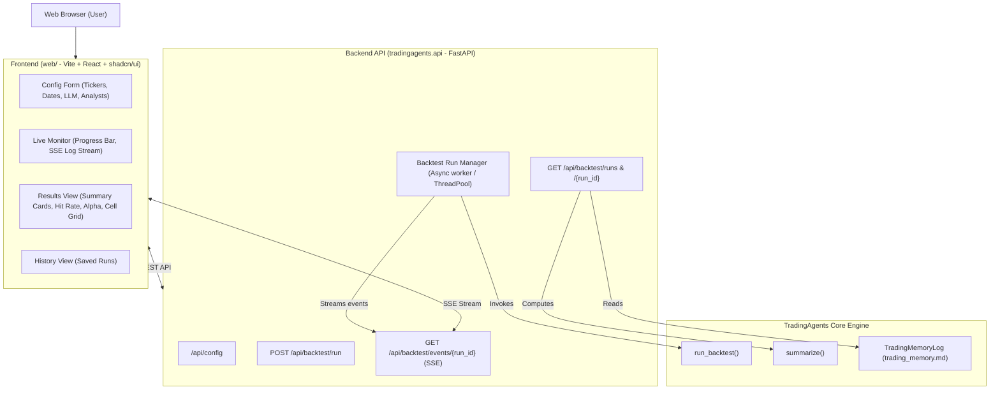

# Technical Design: Web UI for Configuration & Backtesting

## 1. System Architecture



## 2. Backend Design (`tradingagents/api`)

### 2.1 Dependencies
- `fastapi>=0.115.0`
- `uvicorn>=0.30.0`
- `sse-starlette>=2.1.0` (or native FastAPI StreamingResponse)
- Added to `pyproject.toml` under optional dependencies: `web = ["fastapi", "uvicorn", "sse-starlette"]` or core if preferred.

### 2.2 Endpoints Specification
- `GET /api/config`:
  - Returns default configurations from `build_default_config()`, supported providers, available models per provider, and available analysts.
- `POST /api/backtest/run`:
  - Request body:
    ```json
    {
      "tickers": ["NVDA", "AAPL"],
      "start_date": "2026-08-01",
      "end_date": "2026-09-01",
      "every_n_days": 7,
      "asset_type": "stock",
      "selected_analysts": ["market", "news", "fundamentals"],
      "config_overrides": {
        "llm_provider": "openai",
        "quick_think_llm": "gpt-6-luna",
        "deep_think_llm": "gpt-6-sol",
        "max_debate_rounds": 1,
        "max_risk_discuss_rounds": 1
      },
      "run_id": null
    }
    ```
  - Response: `{ "run_id": "20261102_141000", "total_cells": 10, "status": "started" }`
- `GET /api/backtest/events/{run_id}`:
  - Server-Sent Events stream emitting:
    - `event: progress`: `{"done": 1, "total": 10, "ticker": "NVDA", "date": "2026-08-01", "percent": 10}`
    - `event: log`: `{"level": "info", "message": "Analyzing NVDA for 2026-08-01..."}`
    - `event: cell_complete`: `{"ticker": "NVDA", "date": "2026-08-01", "rating": "Buy", "alpha": "+2.5%"}`
    - `event: complete`: `{"summary": { ... }, "status": "completed"}`
    - `event: error`: `{"error": "message"}`
- `POST /api/backtest/runs/{run_id}/stop`:
  - Signals cancellation to the running backtest task.
- `GET /api/backtest/runs`:
  - Scans `{results_dir}/backtest/` for directories. Returns list of run summaries.
- `GET /api/backtest/runs/{run_id}`:
  - Parses `trading_memory.md` of the specified run and returns `{ summary: BacktestSummary, entries: [...], failures: [...] }`.

### 2.3 Run Execution Manager
- Backtests are CPU/network intensive; `run_backtest` runs synchronously in Python.
- Execution is dispatched to a background thread (`concurrent.futures.ThreadPoolExecutor` or `asyncio.to_thread`).
- A thread-safe queue (`asyncio.Queue`) delivers events from the callback `progress(done, total, ticker, date)` and custom logging handlers into the SSE generator.
- Graceful cancellation support via cancellation event flag.

## 3. Frontend Design (`web/`)

### 3.1 Project Structure
```
web/
├── index.html
├── package.json
├── tsconfig.json
├── vite.config.ts
├── tailwind.config.js
└── src/
    ├── main.tsx
    ├── App.tsx
    ├── components/
    │   ├── ui/               # shadcn/ui components (button, card, dialog, input, select, tabs, progress, badge, etc.)
    │   ├── Header.tsx        # App header & status indicator
    │   ├── ConfigPanel.tsx   # Backtest parameter form
    │   ├── LiveMonitor.tsx   # Progress bar, status & real-time log terminal
    │   ├── ResultsPanel.tsx  # KPI cards, Rating breakdown, Cell grid
    │   └── HistoryPanel.tsx  # Run history drawer/table
    ├── hooks/
    │   ├── useBacktest.ts    # SSE stream listener & state
    │   └── useConfig.ts      # API fetcher for defaults
    ├── types/
    │   └── index.ts          # TypeScript interfaces matching backend models
    └── lib/
        ├── utils.ts          # shadcn cn() utility
        └── api.ts            # Fetch client
```

### 3.2 Visual & UX Flow
1. **Config View**:
   - Modern dark-themed financial trading desk aesthetic (slate/zinc palette with emerald/rose accents).
   - Input presets: "Mag 7", "Semiconductors", "Crypto Major", or custom input.
   - Date pickers with quick presets: "Last 1 Month", "Last 3 Months", "Year to Date".
   - Sliders/Number inputs for debate rounds.
2. **Monitor View**:
   - Dynamic progress ring/bar.
   - Animated status badge (e.g. "Analyzing AAPL 2026-08-15 - Risk debate round 1...").
   - Live streaming terminal log view with auto-scroll and pause toggle.
3. **Analytics View**:
   - Summary Metric Cards:
     - Win Rate / Hit Rate (with colored badge)
     - Mean Alpha vs Benchmark (% outperformance)
     - Resolved vs Pending Cells
   - Rating Breakdown (Cards & Bars: Buy, Overweight, Hold, Underweight, Sell).
   - Interactive Data Table: sort by ticker, date, rating, alpha return; filter by outcome (positive/negative alpha).

## 4. Integration & CLI Entry Point
- Add CLI command to `cli/main.py`:
  ```bash
  tradingagents web [--port 8000] [--host 127.0.0.1] [--dev]
  ```
  - In `--dev` mode, launches FastAPI backend, and optionally Vite dev server.
  - In production mode, FastAPI can serve the prebuilt static assets from `web/dist`.
